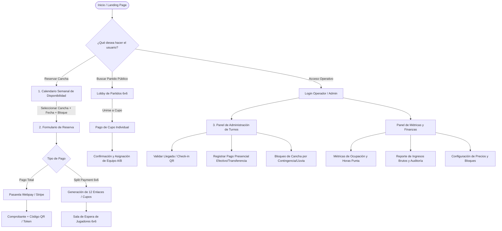

# Documento de Especificación UI/UX y Flujo de Navegación
**Proyecto:** Futbolito 7 — Plataforma Web de Gestión y Reservas para Complejos Deportivos  
**Autor:** Mario Carrasco (Diseñador UI/UX / Desarrollador Frontend)  
**Work Item:** Issue #5 — *Diseñar Wireframes y Flujo de Navegación (UI/UX)*  
**Sprint:** Sprint 1  

---

## 1. Resumen Ejecutivo y Objetivos de Experiencia de Usuario (UX)

El objetivo de este diseño es proveer una interfaz limpia, intuitiva y ágil para eliminar la fricción en el arriendo de canchas de fútbol amateur. 

### Principios de Diseño:
1. **Inmediatez (HTMX-driven):** El usuario debe poder consultar disponibilidad y filtrar fechas/canchas sin recargas completas de pantalla.
2. **Claridad Tarifaria:** Diferenciación visual inmediata entre horarios **Valle** y **Punta**, y desglose transparente en pagos divididos (*Split Payment*).
3. **Diseño Mobile-First & Desktop Adaptive:** Adaptado tanto a jugadores que reservan desde smartphones en la cancha como a administradores en escritorios de recepción.

---

## 2. Mapa de Navegación y Flujo de Usuario (User Journeys)

---

## 3. Especificación Detallada de los 3 Wireframes Clave

### Wireframe 1: Calendario Semanal de Disponibilidad (Jugador & Recepción)
* **Propósito:** Mostrar una grilla temporal (Lunes a Domingo, 08:00 a 23:00) con el estado de cada bloque de 60 minutos.
* **Componentes Clave:**
  - **Barra de Filtros:** Selector de fecha (Semana actual / Selector Datepicker), selector de Cancha (Cancha 1 - Techada, Cancha 2 - Césped Sintético Pro, etc.), y switch de tipo de vista (Día / Semana).
  - **Leyenda Visual de Estados:**
    - 🟢 *Disponible (Horario Valle)* — ej. $25.000 / hora
    - 🟡 *Disponible (Horario Punta)* — ej. $38.000 / hora
    - 🔴 *Ocupado / Confirmado*
    - 🟠 *En Proceso de Reserva (Bloqueo temporal 10 min)*
    - ⚫ *Mantenimiento / Deshabilitado*
  - **Interactividad HTMX:** Al hacer click en una celda libre, se despliega un Drawer/Modal lateral con el resumen del bloque y botón *Continuar Reserva*.

---

### Wireframe 2: Formulario Interactivo de Reserva y Split Payment
* **Propósito:** Capturar los datos del titular de la reserva, permitir la elección de modalidad y gestionar el pago.
* **Componentes Clave:**
  - **Resumen del Bloque:** Cancha elegida, fecha, horario (ej. 20:00 - 21:00) y tarifa aplicada.
  - **Datos del Capitán/Titular:** Nombre completo, teléfono WhatsApp (para recordatorios), correo electrónico.
  - **Selector de Modalidad de Pago:**
    1. *Pago Total Inmediato:* El capitán paga el 100% de la cancha vía Webpay / Tarjeta.
    2. *Split Payment (División en 12 cupos para 6v6):* Cada jugador paga su cuota ($3.166 c/u). Se genera un link para compartir por WhatsApp con temporizador de 12 horas.
    3. *Pago en Recepción (Sólo para usuarios autorizados/habituales).*
  - **Aceptación de Políticas:** Términos de cancelación (tiempo límite de 4 horas antes del partido para reembolso).

---

### Wireframe 3: Panel de Administración de Turnos y Finanzas (Dueño / Recepción)
* **Propósito:** Centro de comando para el recepcionista y dueño del complejo.
* **Componentes Clave:**
  - **KPI Cards Superiores:**
    - *Ingresos del Día:* Total facturado ($ CLP).
    - *Ocupación Hoy:* Porcentaje de canchas ocupadas (ej. 85%).
    - *Partidos Pendientes de Check-in:* Cantidad de reservas próximas.
    - *Alertas de Canchas:* Bloqueos por mantenimiento.
  - **Tabla Operativa del Día (Turnos en Vivo):**
    - Listado cronológico de partidos, nombre del titular, estado de pago (Pagado 100%, Pendiente $X, Split 8/12), acciones rápidas (*Validar Llegada*, *Registrar Cobro Manual*, *Reprogramar*).
  - **Gráfico / Métricas de Finanzas:**
    - Gráfico de barras con ingresos semanales por cancha y desglose entre horario punta vs valle.
