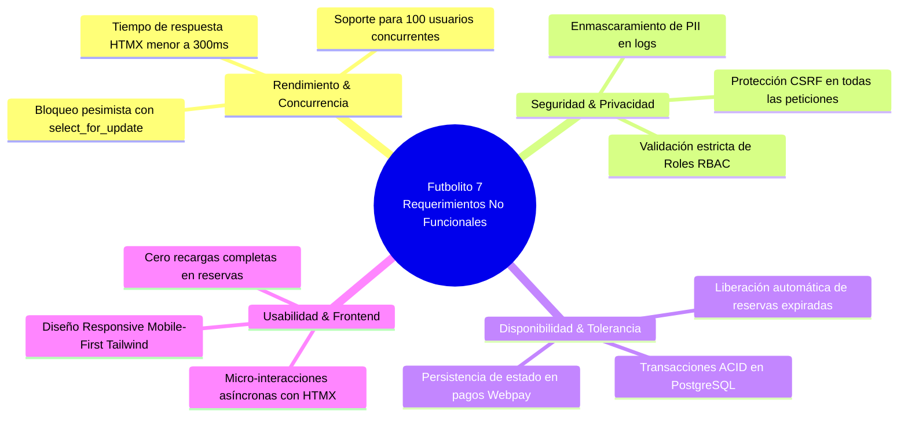

# Especificación de Requerimientos del Sistema (SRS)
## Futbolito 7 — Plataforma Web de Gestión y Reservas para Complejos Deportivos

**Autor / Responsable:** Paulo Benjamín Alegría Díaz (Analista Funcional)  
**Work Item:** Issue #3 — *Levantar Requerimientos Funcionales y No Funcionales*  
**Sprint:** Sprint 1 | **Iteración:** Futbolito 7\Sprint 1  
**Estándar:** IEEE 830 / Formato Ágil con Criterios de Aceptación Gherkin (Given-When-Then)  

---

## 1. Alcance y Contexto del Negocio
Futbolito 7 es una plataforma web monolítica modular orientada a la digitalización integral de complejos deportivos de fútbol amateur. Resuelve la gestión manual de arriendos, solapamiento de reservas, cobros pendientes y falta de jugadores mediante automatización por bloques horarios, pasarelas de pago, división de cuentas (*Split Payment*) y salas públicas de *Matchmaking 6v6*.

---

## 2. Requerimientos Funcionales (RF)

| ID | Módulo | Nombre del Requerimiento | Descripción | Prioridad |
|---|---|---|---|:---:|
| **RF-01** | Canchas | Gestión de Complejo y Canchas | El sistema debe permitir registrar canchas con atributos específicos: superficie (pasto sintético, caucho, techada/aire libre), estado operativo y dimensiones. | Alta |
| **RF-02** | Reservas | Agendamiento por Bloques Horarios | El sistema debe permitir la reserva de canchas en bloques cerrados de 60 minutos (ej. 19:00 - 20:00). Debe aplicar control estricto de concurrencia a nivel de base de datos para evitar doble reserva (*overbooking*). | Crítica |
| **RF-03** | Tarifas | Tarifas Diferenciadas (Punta / Valle) | El sistema debe permitir configurar precios dinámicos según el día de la semana y el bloque horario (Horario Valle diurno vs. Horario Punta nocturno y fines de semana). | Alta |
| **RF-04** | Matchmaking | Salas Públicas 6v6 y Balanceo | El sistema debe permitir la creación de salas públicas para completar 12 cupos individuales. Al completarse los 12 cupos, un algoritmo balanceará o distribuirá a los jugadores en Equipo A (6) y Equipo B (6). | Alta |
| **RF-05** | Pagos | Pago Total y Split Payment | El sistema debe permitir dos modalidades de pago en línea: pago del 100% por el capitán o generación de 12 enlaces de pago independientes con tiempo límite de expiración (12 horas). | Crítica |
| **RF-06** | Pagos | Registro de Cobro Presencial | El recepcionista debe poder registrar cobros directos en caja (efectivo / transferencia bancaria) actualizando el estado de la reserva a "Pagada en Recepción". | Alta |
| **RF-07** | Cancelaciones | Políticas de Anulación y Reembolso | El sistema debe permitir anular o reprogramar reservas con un tiempo mínimo configurable (ej. 4 horas antes). Si se anula a tiempo, el bloque queda inmediatamente disponible para otros usuarios. | Media |
| **RF-08** | Operaciones | Panel de Turnos y Check-in QR | El recepcionista debe contar con un panel en vivo para validar la llegada de los equipos mediante escaneo de código QR o validación manual. | Alta |
| **RF-09** | Reportes | Métricas Financieras y Ocupación | El dueño debe visualizar dashboards con agregaciones en tiempo real: ingresos brutos, porcentaje de ocupación mensual y horas de mayor demanda. | Alta |
| **RF-10** | Auditoría | Registro de Auditoría con Anonimización PII | El sistema debe registrar automáticamente en `AuditLog` toda acción crítica (creación/cancelación de reservas, cobros manuales), aplicando enmascaramiento de datos personales sensibles (RUT, teléfonos, correos). | Alta |

---

## 3. Historias de Usuario y Criterios de Aceptación (Gherkin)

### US-01: Reserva de Cancha con Control de Concurrencia
* **Como:** Jugador registrado o invitado.
* **Quiero:** Seleccionar una cancha, fecha y bloque disponible en el calendario interactivo.
* **Para:** Asegurar mi partido sin riesgo de que otro usuario tome el mismo horario simultáneamente.

```gherkin
Scenario: Reserva exitosa de bloque libre
  Given que el bloque de las 20:00 - 21:00 de la Cancha 1 está en estado "Disponible"
  When el jugador selecciona el bloque e inicia el checkout
  Then el sistema bloquea temporalmente el horario por 10 minutos
  And si el pago es confirmado, el estado cambia a "Reservado"

Scenario: Intento de reserva concurrente sobre el mismo bloque
  Given que el usuario A está procesando el pago del bloque 20:00 - 21:00
  When el usuario B intenta hacer clic y reservar el mismo bloque
  Then el sistema responde vía HTMX con mensaje "Bloque temporalmente no disponible"
  And no permite duplicar la transacción
```

---

### US-02: División de Pago (Split Payment 6v6)
* **Como:** Capitán de equipo.
* **Quiero:** Reservar la cancha dividiendo el costo total en 12 cupos individuales.
* **Para:** No tener que cobrar manualmente a cada uno de mis amigos antes de jugar.

```gherkin
Scenario: Generación y completitud de enlaces Split Payment
  Given una reserva de $36.000 seleccionada en modalidad "Split Payment"
  When el capitán paga su cuota de $3.000
  Then el sistema genera un token/enlace para 11 jugadores restantes
  And establece un temporizador de expiración de 12 horas
  When los 11 jugadores pagan su cuota respectiva
  Then la reserva pasa a estado "Completada y Confirmada"
```

---

### US-03: Matchmaking Público 6v6 y Armado de Equipos
* **Como:** Jugador individual sin equipo completo.
* **Quiero:** Unirme a una sala pública de partido 6v6 pagando mi cupo individual.
* **Para:** Jugar fútbol amateur con otros jugadores de la comunidad.

```gherkin
Scenario: Cierre de sala 6v6 y asignación de equipos
  Given una sala de matchmaking con 11 jugadores inscritos y pagados
  When el jugador número 12 paga su cupo
  Then la sala se cierra automáticamente
  And el sistema ejecuta el algoritmo de distribución asignando 6 jugadores al Equipo A y 6 al Equipo B
  And notifica a todos los participantes con el detalle de la cancha y equipos
```

---

### US-04: Auditoría y Enmascaramiento de Datos Personales (PII)
* **Como:** Administrador / Oficial de Seguridad.
* **Quiero:** Que todas las operaciones de pago y reserva queden auditadas sin exponer datos personales no cifrados.
* **Para:** Cumplir con normativas de privacidad y seguridad de la información.

```gherkin
Scenario: Registro en AuditLog de un cobro presencial
  Given que el recepcionista registra un pago presencial para el cliente "Mario Carrasco" con correo "mario@correo.cl"
  When se guarda el registro de auditoría
  Then el modelo AuditLog almacena el usuario operador, fecha, IP y acción
  And los datos del cliente quedan enmascarados como "M***o C***o" y "m***@correo.cl"
```

---

## 4. Requerimientos No Funcionales (RNF)



| ID | Categoría | Requerimiento No Funcional | Métrica / Criterio de Aceptación |
|---|---|---|---|
| **RNF-01** | **Rendimiento** | Tiempo de Respuesta | Las peticiones parciales de HTMX (filtrado de fechas, consulta de disponibilidad) deben responder en menos de **300 ms**. |
| **RNF-02** | **Concurrencia** | Integridad Transaccional | El motor de reservas debe utilizar transacciones con aislamiento y `select_for_update()` en PostgreSQL para garantizar que no existan carreras críticas (*race conditions*). |
| **RNF-03** | **Seguridad** | Protección contra Ataques Comunes | Protección obligatoria contra CSRF, SQL Injection (mediante ORM Django), XSS y cabeceras de seguridad seguras (`X-Content-Type-Options`, `Content-Security-Policy`). |
| **RNF-04** | **Privacidad** | Enmascaramiento PII | Ningún dato personal sensible (número de teléfono, correo completo, medios de pago) debe guardarse en texto plano dentro de tablas de auditoría (`AuditLog`). |
| **RNF-05** | **Disponibilidad** | Manejo de Expiración de Bloqueos | Un proceso en segundo plano (Celery/Cron/Background Task) debe liberar y cambiar a estado "Disponible" todo bloque temporal cuyo pago no se haya completado tras 10 minutos. |
| **RNF-06** | **Mantenibilidad** | Arquitectura Monolítica Modular | Código desacoplado en aplicaciones Django (`canchas`, `reservas`, `matchmaking`, `pagos`, `auditoria`) con cobertura de pruebas unitarias mínimas del 80%. |
| **RNF-07** | **Compatibilidad** | Responsive Design | Interfaz 100% operable en navegadores modernos móviles (Chrome Mobile, Safari iOS) y de escritorio (resoluciones desde 360px hasta 4K). |
